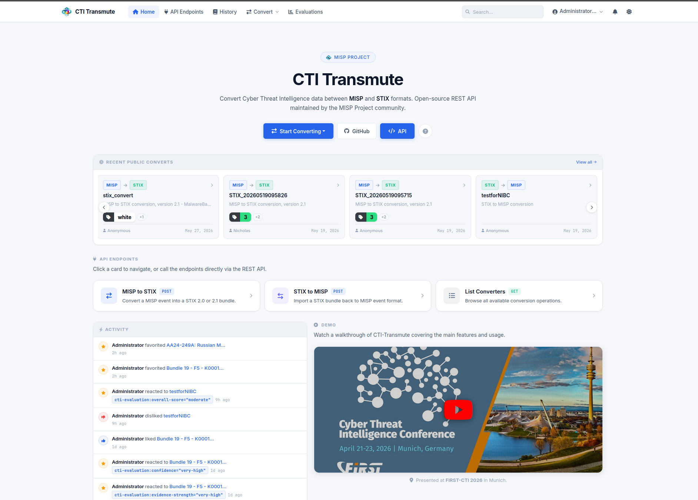
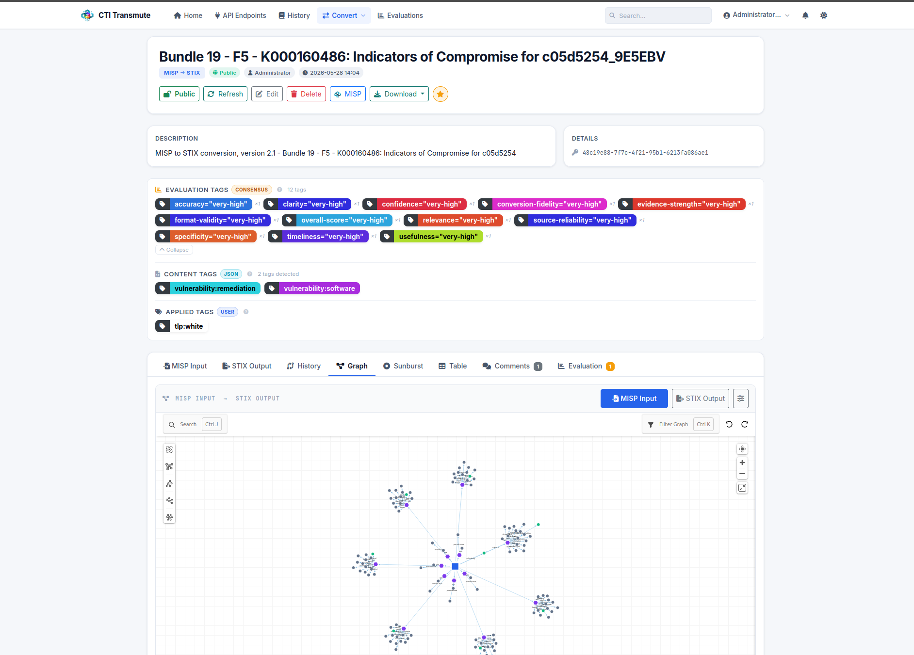
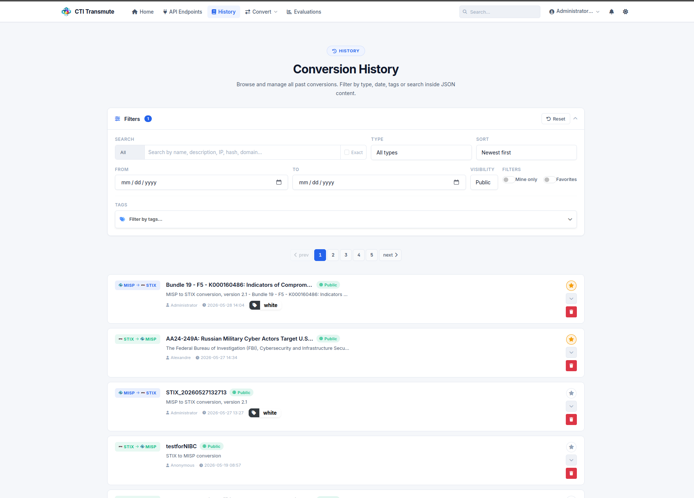

# CTI-Transmute


An **online service for converting cyber threat intelligence format** ([CTI-Transmute.org](https://cti-transmute.org/)), built to **promote interoperability and seamless data exchange**. This repository includes the complete source code of the online service if you want to run it locally. This service **leverages** the **misp-stix open-source library** ([misp-stix](https://github.com/misp/misp-stix)) to facilitate conversion.

## Main Features

* **API**: A quick and easy-to-use **API** for converting between the **MISP** ([MISP standard](https://misp-standard.org/)) and **STIX** formats.
* **User Management**: An **intuitive interface** to manage users of the service.
* **History**: Keeping track of all the conversions (**private and public**). API clients opt in with **`?persist=true`** (see [API authentication and persistence](#api-authentication-and-persistence)).
* **Diffing**: **Reviewing changes** of conversions and updates in the CTI file converted — available for any conversion saved via the UI or a persisting API call.
* **Share**: A **Share link** to allow users to share conversions with private groups — persisted API conversions get one too.
* **Live Conversion**: Users can directly convert **CTI documents** (MISP events, STIX bundles) in the **UI or via the API**.
* **MISP Integration**: **Browse and import events** straight from a connected **MISP instance** on the conversion page, and **push converted events back** to an instance.

## Demo

A video walkthrough of CTI-Transmute is available on YouTube. It covers the main features and usage of the service.

[](https://www.youtube.com/watch?v=-9GbyvoktXc&t=7973s)

## Screenshots

| Home Dashboard | Conversion Detail | Conversion History |
| :---: | :---: | :---: |
|  |  |  |


## Installation

### Prerequisites

- Python 3.10 or higher
- A recent version of `uv` — installation instructions [here](https://docs.astral.sh/uv/getting-started/installation/)
- PostgreSQL (the default credentials are `cti_user / cti_pass` on `localhost:5432/cti_db`)

### Fresh install on a new machine

```bash
# 1. Clone with submodules (misp-taxonomies, misp-galaxy, pivotick)
git clone --recurse-submodules https://github.com/MISP/cti-transmute.git
cd cti-transmute

# 2. One-shot init: install deps + create DB + run migrations
uv run manage init

# 3. Start
uv run manage start
```

> **Note:** `uv run manage init` tries to create the PostgreSQL role and database automatically (connecting as the `postgres` superuser). If that fails due to permissions, create them manually first:
> ```sql
> CREATE ROLE cti_user WITH LOGIN PASSWORD 'cti_pass';
> CREATE DATABASE cti_db OWNER cti_user;
> ```
> Then re-run `uv run manage init`.

### Serving over plain HTTP

Session cookies are stamped `Secure` by default, and browsers only keep a
`Secure` cookie over HTTPS. `localhost` and `127.0.0.1` are exempt, so a local
install needs nothing extra. An instance reached over plain HTTP at an IP or
hostname is not exempt: the browser silently discards the cookie, no session
ever forms, and logging in or converting anything fails. Add the opt-out to
your `.env`:

```bash
SESSION_COOKIE_SECURE=false
```

Only do this when the instance is reachable solely from a network you trust -
without `Secure`, the session cookie travels in clear text and anyone on the
path can reuse it. Prefer HTTPS.

Behind a TLS-terminating nginx or Apache, keep the default, and make sure the
proxy forwards the original scheme — nginx does not do this on its own. The
sample in [Reverse proxy](#reverse-proxy) does.

Without that header the application sees plain HTTP, and sets a `Secure`
cookie the browser will keep (the connection to it *is* HTTPS) while reporting
the mismatch on any failed form submission.

### Setting a secret key

`SECRET_KEY` signs the session cookie. Unset, it falls back to a value
published in this repository, which lets anyone forge a session for your
instance. Set it in `.env` before exposing the service:

```bash
SECRET_KEY=$(openssl rand -hex 32)
```

### Managing the service

CTI-Transmute ships with a `manage` script that covers all day-to-day operations:

```bash
uv run manage init             # First-time setup (submodules + deps + DB + migrations)
uv run manage start            # Run the website in the foreground (development)
uv run manage update           # Pull latest code + sync deps + run DB migrations
uv run manage update-datasets  # Refresh misp-taxonomies + misp-galaxy to upstream HEAD
uv run manage backup           # Backup the PostgreSQL database
uv run manage deploy           # backup → update → restart the systemd service
uv run manage db               # Run flask db upgrade (or: db migrate, db downgrade…)
uv run manage help             # Show all commands
```

**Daily development** — run the app in your terminal:

```bash
uv run manage start
```

This is a **development command**: the server dies with your shell, and nothing
starts it again. A production instance is owned by systemd instead — see
[Running in production](#running-in-production).

**After pulling new code** (migrations run automatically):

```bash
uv run manage update
uv run manage start
```

**Refreshing the MISP tag datasets** — `update` checks out the submodule
pointers the repository records, so misp-taxonomies and misp-galaxy stay where
they are pinned and two installs updated a week apart carry the same tag set.
Moving them to upstream HEAD is a separate, deliberate step:

```bash
uv run manage update-datasets   # advances the two dataset submodules
```

Then load the new entries from the **Tag Management** admin page, with its
*Taxonomies* and *Galaxies* import buttons; existing tags are never modified.
Commit the moved pointers afterwards, or the next `update` checks the old ones
back out.

## Running in production

`start_website` serves the application through **gunicorn** with a single
threaded worker (`config/generic.json`'s `website_threads`, default 8). One
worker is a capacity choice rather than a correctness constraint, and unlike
the thread count it is not a configuration key: `bin/start_website.py` fixes it
at one. Bulk tag job records live in the database rather than in a worker's
memory, so a second worker would not lose sight of a running job — the work
itself still runs in the process that started it. More workers would buy GIL
parallelism for CPU-bound STIX parsing and cost one SQLAlchemy connection pool
each. Nobody has measured that trade, which is why it stays at one.

### The listen address is not a firewall

The service binds **`0.0.0.0`** by default (`website_listen_ip` in
`config/generic.json`), so a fresh install is reachable on port 6868 from
anywhere that can route to the host. **Do not expose that port directly.** It
speaks plain HTTP, terminates no TLS and rate-limits nothing; put it behind the
reverse proxy and let only the proxy reach it. Nothing in the code can enforce
this — it is the operator's firewall:

```bash
# Example: only the proxy host may reach the application port
sudo ufw allow from <proxy-ip> to any port 6868 proto tcp
sudo ufw deny 6868/tcp
```

When the proxy runs on the same host, the simpler answer is to bind loopback —
set `"website_listen_ip": "127.0.0.1"` in `config/generic.json` and restart.

### The systemd unit

No unit ships with the repository: the user, the paths and the
`WorkingDirectory` differ on every install. Write
`/etc/systemd/system/cti-transmute.service` with the values of yours —
`/opt/cti-transmute` and the `cti-transmute` user below are placeholders:

```ini
[Unit]
Description=CTI-Transmute
Wants=network-online.target
After=network-online.target postgresql.service
Requires=postgresql.service

[Service]
Type=simple
User=cti-transmute
Group=cti-transmute
WorkingDirectory=/opt/cti-transmute
Environment=TRANSMUTE_HOME=/opt/cti-transmute
Environment=PYTHONUNBUFFERED=1
# gunicorn 25.1+ puts its control socket in $XDG_RUNTIME_DIR, falling back to
# $HOME/.gunicorn. Harmless to omit - the socket is optional and its failure is
# only logged - but a service account with no writable home logs it at every
# start.
RuntimeDirectory=cti-transmute
Environment=XDG_RUNTIME_DIR=/run/cti-transmute
# Logged-in sessions, outside the checkout: systemd creates
# /var/lib/cti-transmute owned by User= above, and it survives a deploy.
StateDirectory=cti-transmute
Environment=SESSION_FILE_DIR=/var/lib/cti-transmute/flask-session
ExecStart=/opt/cti-transmute/.venv/bin/start_website
Restart=always
RestartSec=2

[Install]
WantedBy=multi-user.target
```

- `ExecStart` is the console script inside the virtualenv `uv sync` created, by
  its absolute path — systemd hands the unit the system `PATH`, which has no
  virtualenv on it.
- `Requires=postgresql.service` belongs there only while the database is on the
  same host. With PostgreSQL elsewhere, drop that line and the
  `postgresql.service` in `After=`, or the unit refuses to start.
- `TRANSMUTE_HOME` is read before the application loads your `.env`, so the unit
  has to carry it. `SECRET_KEY` and the rest stay in the `.env` in the checkout.
- `SESSION_FILE_DIR` is the session store — where a logged-in user's session
  lives. Sessions are state rather than code: they have to outlive a deploy and
  be writable by the `User=` above, which is what `StateDirectory=` gives you.
  Leave the pair out and the store defaults to `flask_session/` inside the
  checkout, which only works when the service user owns the code. On the two
  ordinary deployments where it does not — a read-only checkout, or one owned
  by `root` and run as `cti-transmute` — the service refuses to start and says
  so, naming the directory and this variable.
- `Restart=always` is the point of the exercise — a worker that dies is
  replaced, and the service comes back after a reboot.
- gunicorn logs every request to standard output, which journald collects.

```bash
sudo systemctl daemon-reload
sudo systemctl enable --now cti-transmute.service   # start, and start on boot
sudo systemctl status cti-transmute.service
sudo systemctl restart cti-transmute.service
sudo journalctl -u cti-transmute.service -f         # live log
```

To check that the unit you wrote actually supervises the service — that a
killed worker is replaced, a killed server is restarted, and the service comes
back after a reboot — run it against your install:

```bash
sudo bin/verify_systemd_unit.sh
```

### Reverse proxy

A TLS-terminating nginx in front of the service:

```nginx
server {
    listen 443 ssl;
    server_name cti-transmute.example.org;

    # ssl_certificate / ssl_certificate_key …

    # Large MISP events: the application accepts 50 MB, nginx defaults to 1 MB
    # and would reject them with a 413 before the request ever arrives.
    client_max_body_size 50m;

    location / {
        proxy_pass http://127.0.0.1:6868;

        proxy_set_header Host              $host;
        proxy_set_header X-Real-IP         $remote_addr;
        proxy_set_header X-Forwarded-For   $proxy_add_x_forwarded_for;
        # Without this the application believes it is serving plain HTTP, and
        # sends no HSTS header on any response.
        proxy_set_header X-Forwarded-Proto $scheme;

        # Conversions run inside the request; matches gunicorn's --timeout.
        proxy_read_timeout 300s;
    }
}
```

### Deploying an update

```bash
uv run manage deploy     # backup → git pull + uv sync + migrations → restart
```

Run it as the user who owns the checkout, **not** under `sudo` — `git pull` and
`uv sync` as root leave root-owned files behind. The restart is the one step
that needs privilege, so it is run as `sudo systemctl restart
cti-transmute.service` and will ask for your password; deploying as root skips
the `sudo`.

On a host with no such unit — a container, a Docker image — the new code is put
in place and the restart command you still have to run is printed, rather than
a second server being started against the port the first one holds.

## Query Examples

The main feature provided with the API is a seamless conversion between CTI standards.

Here are some examples:

* *Get the list of currently supported converters*

```bash
curl -X GET https://cti-transmute.org/api/convert/list
```

This is the canonical source for what the service can convert: one entry per
direction, each with a `params_schema` describing the parameters that direction
accepts. Requesting a direction that is not listed there returns **404**.

* *Convert MISP data to STIX 2.1*

```bash
curl -X POST -H "Content-Type: application/json" -d "@/path/to/misp_data.json" \
https://cti-transmute.org/api/convert/misp_to_stix

# OR
curl -X POST -F "file=@/path/to/misp_data.json" https://cti-transmute.org/api/convert/misp_to_stix
```

* *Convert STIX 2.x Bundle to MISP standard format*

```bash
curl -X POST -H "Content-Type: application/json" -d "@/path/to/stix_data.json" \
https://cti-transmute.org/api/convert/stix_to_misp

# OR
curl -X POST -F "file=@/path/to/stix_data.json" https://cti-transmute.org/api/convert/stix_to_misp
```

Conversion parameters travel in the **query string** — for example, to get a
STIX 2.0 bundle instead of the default 2.1:

```bash
curl -X POST -H "Content-Type: application/json" -d "@/path/to/misp_data.json" \
"https://cti-transmute.org/api/convert/misp_to_stix?version=2.0"
```

An invalid or unknown parameter returns a **400** with `{"error": …, "fields": …}`
pinpointing the rejected field.

The calls above are **stateless**: the response body *is* the converted
document, and nothing is saved on the server. Any call with **`?persist=true`**
instead returns the envelope described in
[API authentication and persistence](#api-authentication-and-persistence) —
the converted document plus the identifiers of the saved Conversion.

## Diagnostics

A conversion can succeed and still alter what it was given: a tag value
sanitised, a duplicated STIX id whose last occurrence wins, an object converted
under an unknown template, an attribute that could not be mapped as sent. The
converter reports those as **Diagnostics** — two buckets, `warnings` (the
output was altered) and `errors` (one attribute or object could not be
converted as sent). Neither means the conversion failed: a conversion that
produced output is a **200**, and a real failure is still the 4xx/5xx described
above.

Both convert routes return the totals in headers, and only when there is
something to say:

```
X-Transmute-Warnings: 3
X-Transmute-Errors: 0
```

Both headers are sent together, or neither. To get the messages themselves, add
**`?diagnostics=true`** — the body then wraps the document instead of being it:

```bash
curl -X POST -H "Content-Type: application/json" -d "@/path/to/stix_bundle.json" \
"https://cti-transmute.org/api/convert/stix_to_misp?diagnostics=true"
```

```json
{
  "conversion": { "Event": { "info": "...", "...": "..." } },
  "diagnostics": {
    "warnings": {
      "bundle--a6ef17d6-91cf-4b34-9b3e-1c2d3e4f5a6b": [
        "Duplicate STIX object id: indicator--... - only the last occurrence is parsed"
      ]
    },
    "errors": {},
    "counts": { "warnings": 1, "errors": 0 }
  }
}
```

The messages are the converter's own, grouped by the identifier they concern
(the bundle or the MISP event), and come through verbatim. Long error lists are
capped with a trailing "… and N more" entry, but the header counts are taken
before the cap, so they stay honest. Without the flag the body is unchanged —
byte for byte what it has always been.

A persisted Conversion keeps the Diagnostics its output came with: they are in
the `?persist=true` envelope, in `GET /api/conversions/<id>` and its
`/history`, and on the Conversion's detail page. Rows saved before Diagnostics
existed read `null` — "not recorded", not "clean".

## API authentication and persistence

The same conversion endpoint supports three flows, from throwaway one-liner to
a fully catalogued Conversion. All three run against `misp_to_stix` below;
everything applies to `stix_to_misp` the same way.

**1. Anonymous, stateless** — quick conversion; nothing is saved on the server:

```bash
curl -X POST -H "Content-Type: application/json" -d "@/path/to/misp_data.json" \
https://cti-transmute.org/api/convert/misp_to_stix
```

The response body is the converted document itself (here: a STIX bundle).

**2. Authenticated, stateless** — same call with your API key; still nothing saved:

```bash
curl -X POST -H "X-API-KEY: <your-api-key>" \
-H "Content-Type: application/json" -d "@/path/to/misp_data.json" \
https://cti-transmute.org/api/convert/misp_to_stix
```

The key identifies you to the service, so scripts can use one call shape for
stateless and persisting requests alike. A wrong key is rejected with a **403**
(`{"message": "Invalid API key"}`) rather than silently treated as anonymous,
so key-rotation mistakes surface immediately.

> **Where to find your API key:** log in and open your account page
> (`/account`) — the key is displayed in your profile.

**3. Authenticated, persisting** — add `?persist=true` to save the result as a
Conversion, exactly as if you had converted through the UI:

```bash
curl -X POST -H "X-API-KEY: <your-api-key>" \
-H "Content-Type: application/json" -d "@/path/to/misp_data.json" \
"https://cti-transmute.org/api/convert/misp_to_stix?persist=true"
```

Instead of the bare document, the response is an envelope — the converted
payload plus the saved Conversion's identifiers:

```json
{
  "conversion": {
    "type": "bundle",
    "id": "bundle--a6ef17d6-91cf-4b34-9b3e-1c2d3e4f5a6b",
    "objects": [ "..." ]
  },
  "diagnostics": {
    "warnings": { "bundle--...": [ "..." ] },
    "errors": {},
    "counts": { "warnings": 2, "errors": 0 }
  },
  "id": 42,
  "uuid": "5bf21cfe-487e-431d-9514-773a9365cde1",
  "url": "/conversions/42"
}
```

The saved Conversion is owned by your account and gets the full catalogue
treatment: it appears in your History, can be refreshed and diffed, shared via
a Share link, and commented on. Read it back over the API (see
[Reading saved conversions over the API](#reading-saved-conversions-over-the-api)):

```bash
curl -H "X-API-KEY: <your-api-key>" https://cti-transmute.org/api/conversions/42
```

Persisting also works **without** an API key — the Conversion is then saved
anonymously (owned by nobody), matching what the web UI does for logged-out
visitors.

## Reading saved conversions over the API

Saved Conversions are readable over the API with the same `X-API-KEY` header —
or anonymously, in which case you see **public Conversions only**, exactly what a
logged-out browser sees. A private Conversion you may not see returns **404**, so
the API never confirms a private row's existence to others. All three routes are
`GET`s.

* *List the Conversions you can see* (paginated):

```bash
curl -H "X-API-KEY: <your-api-key>" https://cti-transmute.org/api/conversions
```

The response is a page envelope — each entry a Conversion summary with its tags:

```json
{
  "data": [
    { "id": 42, "name": "MISP_TO_STIX_...", "conversion_type": "MISP_TO_STIX", "public": true, "tags": [] }
  ],
  "page": 1,
  "per_page": 10,
  "total": 1,
  "total_pages": 1
}
```

Narrow the list with query params: `q` (search), `search_scope`
(`all`/`name`/`description`/`content`), `tags` (comma-separated), `date_from` /
`date_to` (`YYYY-MM-DD`), `sort` (`asc`/`desc`), `visibility` (`public`/`private`),
`mine`, and `type`.

* *Fetch one Conversion in full* (input, output, the params it ran with, and
  its `diagnostics`):

```bash
curl -H "X-API-KEY: <your-api-key>" https://cti-transmute.org/api/conversions/42
```

* *Read a Conversion's accepted re-run history* (the diff timeline; each entry
  carries the `diagnostics` its own output came with):

```bash
curl -H "X-API-KEY: <your-api-key>" https://cti-transmute.org/api/conversions/42/history
```

## Funding 

ENSOC (101127660 — ENSOC — DIGITAL-ECCC-2022-CYBER-03) is a European project co-financed under the call DIGITAL-ECCC-2022-CYBER-03, aiming to create a Crossborder Platform with the purpose of improving the collective security of EU stakeholders and support CSIRTs and SOCs by overlapping defensive capabilities.

The ENSOC Consortium composed of seven member states, namely Austria, Luxembourg, Romania, Netherlands, Portugal, Italy and Spain have joined together to build a collaborative, interoperable and sustainable crossborder SOC platform with the aim to support the detection and prevention of cyber threats.

Co-Funded by the European Union. Views and opinions expressed are however those of the author(s) only and do not necessarily reflect those of the European Union or ECCC. Neither the European Union nor the granting authority can be held responsible for them.


## License

CTI-Transmute is free software released under the "GNU Affero General Public License v3.0".

~~~
Copyright (c) 2025 Computer Incident Response Center Luxembourg (CIRCL)
Copyright (c) 2025 Christian Studer - https://github.com/chrisr3d
Copyright (c) 2025 Theo Geffe - https://github.com/ecrou-exact/ 
~~~
